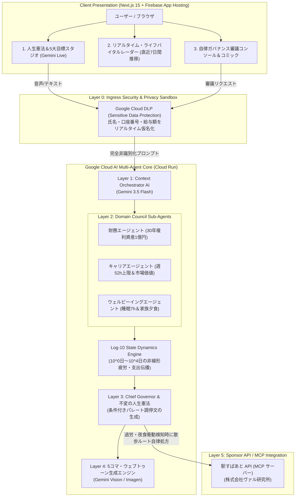

# ⏳ ChronosLife (クロノス・ライフ)
### Log-10 階層的時間 人生ガバナンス＆自律ライフガードOS
> **第5回 Agentic AI Hackathon with Google Cloud 出品作**  
> 「作る」から「使える」へ ―― 厳格なガバナンスとセキュリティを備えた自律型マルチエージェント

[](https://chronoslife-web--chronos-life-510315.asia-east1.hosted.app/ja)
[](https://chronoslife-backend-27246861924.asia-northeast1.run.app)
[-10b981?style=for-the-badge)](https://roote.ekispert.net/)
[](LICENSE)

---

## 🌟 プロジェクト概要

$10^0$日（1日）の衝動的な浪費や残業から、$10^4$日（約30年）の不変の人生憲法まで――  
**Log-10 等間隔階層時系列モデル（Log-10 HTM）**によって、現代人が直面する**因果関係の断絶（Vanishing Causality）**を数学的に解消。

個人のプライバシーを **Google Cloud DLP (Sensitive Data Protection)** で入口保護し、有限な人生リソース（資本・時間・健康）を巡る各専門AIエージェント（財務・キャリア・ウェルビーイング）の葛藤を、**最高仲裁官（Chief Governor AI）**がパレート最適解へと自律調停します。

---

## 🌐 本番稼働リンク (Live URLs)

- **フロントエンド (Web App)**: [https://chronoslife-web--chronos-life-510315.asia-east1.hosted.app/ja](https://chronoslife-web--chronos-life-510315.asia-east1.hosted.app/ja)
- **バックエンド (Cloud Run)**: [https://chronoslife-backend-27246861924.asia-northeast1.run.app](https://chronoslife-backend-27246861924.asia-northeast1.run.app)
- **事前審査用ワンクリック体験**: 会員登録やログイン不要で、ブラウザから即座に3大シナリオ＆Gemini Live対話をお試しいただけます。

---

## 🏛️ 6層自律ガバナンス・アーキテクチャ (6-Layer Architecture)



---

## 🎯 審査員向け 3大実演デモシナリオ

| # | シナリオ名 | 解決する課題と技術ハイライト | 自律処方 / 調停結果 |
|---|-----------|-----------------------------|--------------------|
| **1** | **深夜の衝動支出と30年複利逆伝播** | 金曜夜、Amazonで限定版キーボード（9,800円）を衝動買い。**Cloud DLP** が口座番号と氏名を即座にマスク。$10^0$日の浪費が30年後のリタイア資産に与える複利損失を逆伝播。 | **条件付き修正**: 支出を承認する代わりに、L1（10日間）スプリント内で外食費を3日間3,260円ずつ減額吸収。 |
| **2** | **高年収スタートアップ転職の相反調停** | 年収350万円アップだが週70時間労働オファー。**財務AI（賛成）** vs **健康・家族AI（断固反対）** の価値観衝突。 | **原案却下＆パレート対案**: 週4回家族夕食と趣味4時間を死守するため、週52時間上限＋テレワーク確約での再交渉ガイドを提示。 |
| **3** | **連続残業バーンアウトと緑地散歩処方** | 3日連続22時退勤で夜食（3,000円）衝動。疲労指数の急上昇を検知し、**駅すぱあと API MCP** と連携。 | **物理世界介入**: 新宿駅で「15分リフレッシュ緑地徒歩ルート」を案内し、前頭葉の意志力回復と夜食を自律防衛。 |

---

## 🛠️ Google Cloud 技術スタックと加点対応

- **Google Cloud Run**: バックエンド（FastAPI Dockerコンテナ）を `asia-northeast1`（東京）に完全サーバレス配備。
- **Firebase App Hosting**: フロントエンド（Next.js 15）のグローバルホスティング（**スポンサー加点獲得**）。
- **駅すぱあと API MCP (Model Context Protocol)**: 株式会社ヴァル研究所の交通APIを活用したモビリティ自律処方（**スポンサー加点獲得**）。
- **Google Cloud DLP (Sensitive Data Protection)**: PII（氏名・口座・給与情報）を実時間で暗号トークン化し、外部LLMの漏洩と過剰迎合を防止（**テーマ適合**）。
- **Gemini Live (双方向音声＆テキスト)**: ユーザーのリアルタイム音声から人生憲法を対話的に引き出し、5大目標カードを直接同期。

---

## 💻 ローカル開発・検証手順

```bash
# 1. リポジトリのクローン
git clone https://github.com/JJ6415/ChronosLife.git
cd ChronosLife

# 2. バックエンドの起動 (Python 3.11+)
cd backend
python -m venv venv
# Windows:
.\venv\Scripts\activate
# Mac/Linux:
# source venv/bin/activate
pip install -r requirements.txt
uvicorn main:app --reload --port 8080

# 3. フロントエンドの起動 (別のターミナル)
cd ../frontend
npm install
npm run dev
# http://localhost:3000 にアクセス
```

---

## 📄 ライセンス

本プロジェクトは **MIT License** のもとで公開されています。  
*第5回 Agentic AI Hackathon with Google Cloud 提出用*
