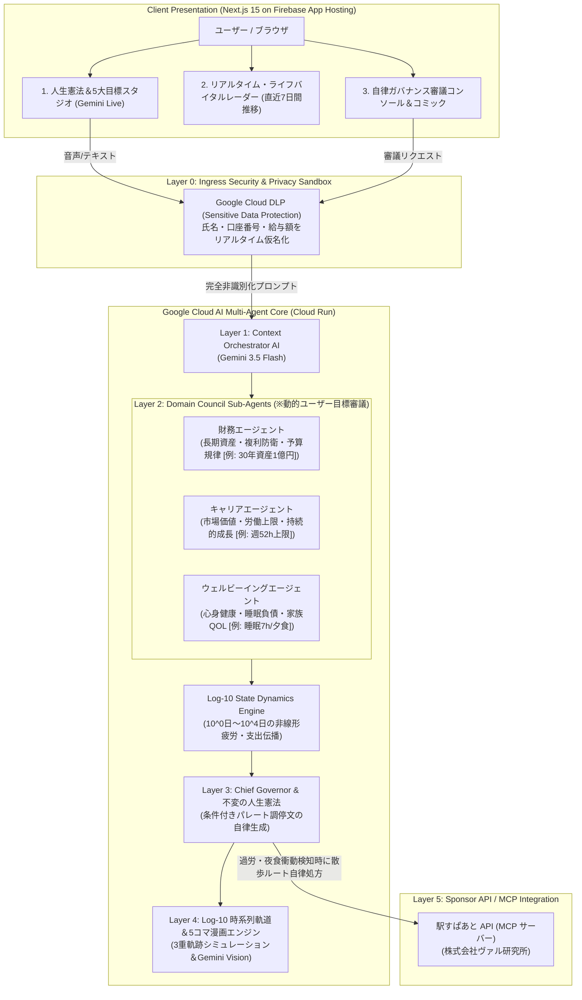

# 1. はじめに：「作る」から「使える」AIエージェントへ

LLMの急速な進化により、個人や小規模チームでも「自律型AIエージェント」を素早くプロトタイピングできる時代になりました。しかし、それを実社会や個人の重大な意思決定に導入し、**「本当に使える道具」**として定着させるためには、乗り越えなければならない本質的な壁が存在します。

それが**「野良エージェント化（暴走・無責任な迎合・過剰最適化）」**と**「個人情報の漏洩リスク」**です。

本プロジェクト **『ChronosLife（クロノス・ライフ）』** は、第5回 Agentic AI Hackathon with Google Cloud のメインテーマである **「作る」から「使える」へ ―― ガバナンスとセキュリティを備えたAIエージェント** に真正面から応えるために開発された、**Log-10 階層的時間 人生ガバナンス＆自律ライフガードOS**です。

- 🌐 **Live Web App (Firebase App Hosting)**: [https://chronoslife-web--chronos-life-510315.asia-east1.hosted.app/ja](https://chronoslife-web--chronos-life-510315.asia-east1.hosted.app/ja)
- 🚀 **Backend API (Google Cloud Run)**: [https://chronoslife-backend-27246861924.asia-northeast1.run.app](https://chronoslife-backend-27246861924.asia-northeast1.run.app)
- 📦 **GitHub Repository**: [https://github.com/JJ6415/ChronosLife](https://github.com/JJ6415/ChronosLife)

---

# 2. 解決する課題：因果関係の断絶（Vanishing Causality）

現代のビジネスパーソンは、日々の生活の中で「目先の快楽・衝動」と「長期的な幸福・目標」の激しい板挟みに苦しんでいます。

- 金曜の深夜、ストレス解消でポチってしまう1万円のキーボード
- 3日連続22時までの残業と、疲れ果てた帰り道での深夜デリバリー衝動
- 年収350万円アップだが、週70時間労働を強いられるスタートアップへの転職オファー

人間の脳は、**「今日1日（$10^0$日）の微小な選択や妥協」が「30年後（$10^4$日）の引退資産や健康寿命」にどのような複利損失をもたらすか**を直感的に計算できません。私たちはこの認知的限界を**「因果関係の断絶（Vanishing Causality）」**と定義しました。

従来のライフログや家計簿アプリは単なる「過去の記録簿」に過ぎず、ChatGPTなどの汎用AIチャットはユーザーの機密情報（口座番号・資産額・家族構成）を平文で送信してしまうプライバシーの懸念に加え、ユーザーに心地よい言葉ばかり返す**「迎合（Sycophancy）」**に陥りがちです。

ChronosLifeは、**Google Cloudのエンタープライズセキュリティ基盤**と**Geminiマルチエージェント調停**によってこの課題を根本から解決します。

---

# 3. 6層自律ガバナンス・アーキテクチャ

ChronosLifeは、入口でのプライバシー防衛から物理世界への行動処方まで、厳密に分離された6つのレイヤーで構成されています。

> **※ 各エージェントの動的設計について:**  
> 上記ダイアグラムの括弧内数値（1億円、週52h上限等）は動作確認用の代表ベンチマーク例です。実際の運用では、ユーザーが「人生憲法スタジオ」で対話的に策定した個人の価値観・目標値が動的に各エージェントへインジェクションされ、個別最適化された評価が行われます。

---

# 4. 技術的ハイライトとGoogle Cloud実装の詳細

### ① Layer 0: Google Cloud DLP によるゼロトラスト・プライバシー保護
ユーザーが「妻のスジンと三菱UFJ銀行 005-1234567 口座からボーナス30万円が入った」と入力した際、バックエンド最前線に配置された **Google Cloud DLP (Sensitive Data Protection)** APIが作動します。
- 氏名、口座番号、給料・ボーナス金額をミリ秒単位で検知。
- `[PERSON_NAME_1]`, `[FINANCIAL_ACCOUNT_NUMBER]`, `[CONFIDENTIAL_BONUS]` といった決定論的サロゲートトークンへと入口で即時仮名化。
- 外部LLMやエージェント間通信には個人を特定できる機密平文が一切送信されません。

### ② Layer 1: Gemini 3.5 Flash によるコンテキスト・オーケストレーション
仮名化されたテキストから、ユーザーの意図（支出、残業、転職オファー等）と具体的な数値パラメータ（金額、勤務時間、ストレス度）を高精度に抽出。下位の専門エージェント群に対して、それぞれのドメインに特化した「審議プロンプト」を自律生成して配分します。

### ③ Layer 2 & 3: マルチエージェント合意形成と最高仲裁官のパレート最適化
人生の有限なリソース（時間・体力・資本）を巡り、各専門エージェントは自らの職務に従って審議します。
- **財務エージェント**: 資産形成・複利防衛・予算規律の視点で審査。
- **キャリアエージェント**: 市場価値向上とバーンアウト上限（週52時間等）の視点で審査。
- **ウェルビーイングエージェント**: 最低睡眠時間（7時間）や家族との食事、QOLの不可侵性を防衛。

エージェント間で意見が割れた場合（例: 財務「賛成」vs ウェルビーイング「反対」）、**最高仲裁官（Chief Governor AI）** が不変の人生憲法を基に調停。単なる多数決や頭ごなしの禁止ではなく、**「週52時間上限とテレワーク確約での再交渉ガイド」のようなパレート改善案（条件付き修正）** を提示します。

### ④ Layer 4: Log-10 非線形時系列力学エンジン
$10^0$日（1日）、$10^1$日（10日スプリント）、$10^2$日（100日クォーター）、$10^3$日（3年チャプター）、$10^4$日（30年憲法）の5段階対数時間軸において、日々の逸脱が将来に及ぼす影響をシミュレーション。
「基準線（Base）」「原案執行（Proposal）」「調停後（Arbitrated）」の3本の軌道を可視化し、一目で影響を実感できるようにしています。

### ⑤ Layer 5: 駅すぱあと API (MCP) による現実世界への自律介入
画面の中で「夜食をやめましょう」「早く休みましょう」と表示するだけでは、意志力の枯渇した人間を行動変容させることはできません。
ChronosLifeは、**株式会社ヴァル研究所の「駅すぱあと API」を Model Context Protocol (MCP) サーバーとして統合**。3日連続残業によるバーンアウト限界を検知した際、ユーザーの退勤経路において「新宿駅での15分リフレッシュ緑地徒歩ルート」を自動処方。実世界での物理的な行動介入により、過食や夜食の衝動を未然に防ぎます。

### ⑥ インフラ設計：Cloud Run × Firebase App Hosting
- **Backend**: Python 3.11 / FastAPI コンテナを **Google Cloud Run**（東京リージョン `asia-northeast1`）に完全サーバレス配備。トラフィックに応じた0→Nのオートスケーリングと高可用性を実現。
- **Frontend**: Next.js 15 App Router を **Firebase App Hosting** でグローバル配信。SSRとCDNエッジキャッシュを活かした超高速な初期レンダリングを提供。

---

# 5. 審査員向け 3大実演デモシナリオ

本番URLにアクセスするだけで、審査員が会員登録不要で即座に動作確認できるプリセットを用意しています。

| # | シナリオ名 | 状況設定 | 自律ガバナンスと調停結果 |
|---|-----------|---------|-------------------------|
| **1** | **深夜の衝動支出と30年複利逆伝播** | 金曜深夜、ストレスでAmazonにて9,800円の限定キーボードを衝動買い。 | **Cloud DLP**が口座情報を即時仮名化。1日の浪費が30年後のリタイアを2.4日遅らせる衝撃を可視化。**「条件付き修正」**として、10日スプリント内で外食費を3日間3,260円ずつ減額吸収するパレート対案を提示。 |
| **2** | **高年収スタートアップ転職の相反調停** | 年収350万円アップだが週70時間労働で週末出勤が頻繁なオファー。 | 財務AI（賛成）と健康・家族AI（断固反対）が衝突。最高仲裁官が人生憲法第1条（家族・健康権）を根拠に**「原案却下」**。週52時間上限＋テレワーク確約での再交渉ガイドを自律出力。 |
| **3** | **連続残業バーンアウトと緑地散歩処方** | 3日連続22時退勤中。新宿駅で疲れ果ててUberEats 3,000円を注文したい。 | 意志力枯渇・バーンアウト指数急上昇を検知。**駅すぱあと API (MCP)** と連携し、新宿駅での「15分リフレッシュ緑地徒歩ルート」を自動案内して夜食衝動を未然に防護。 |

---

# 6. おわりに：「暴走しないAI」と歩む持続可能な未来

自律型AIエージェントの価値は、単に「人間の代わりに何でもやってくれること」ではありません。本当に重要なのは、**「人間の長期的な幸福や健康、尊厳を守るために、時には甘い誘惑にブレーキをかけ、建設的な代替案を示してくれること」**です。

ChronosLifeは、Google Cloudの堅牢なセキュリティとGeminiの高度な知性を組み合わせることで、**「野良化せず、プライバシーを死守し、30年先を見据えて人間を伴走する真のライフガード」** を形にしました。

ぜひ、実際のWebアプリケーションでそのガバナンスをご体験ください。

- 🌐 **Webアプリ**: [https://chronoslife-web--chronos-life-510315.asia-east1.hosted.app/ja](https://chronoslife-web--chronos-life-510315.asia-east1.hosted.app/ja)
- 💻 **ソースコード**: [https://github.com/JJ6415/ChronosLife](https://github.com/JJ6415/ChronosLife)
